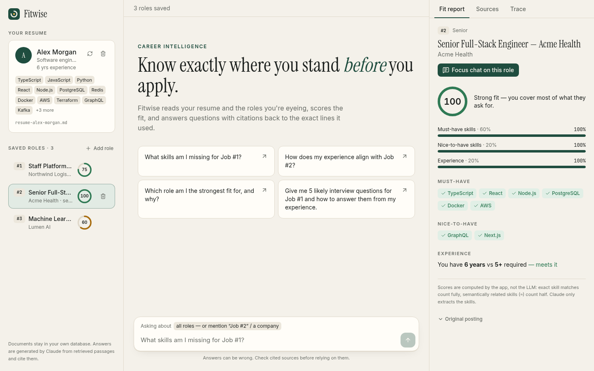
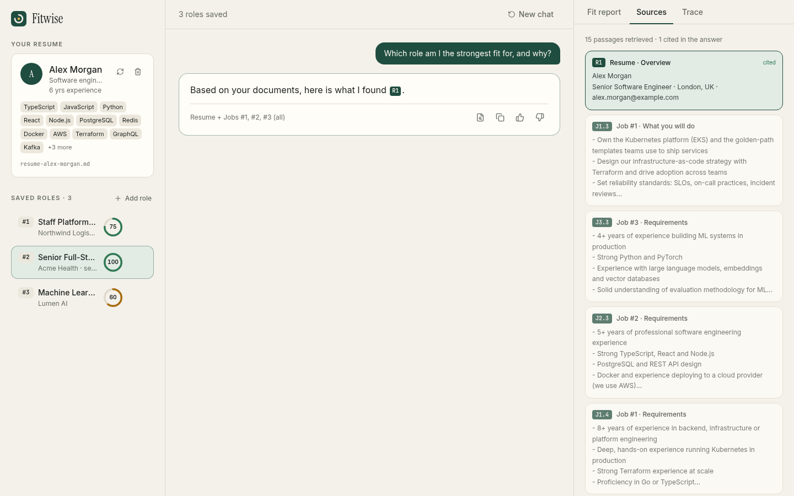
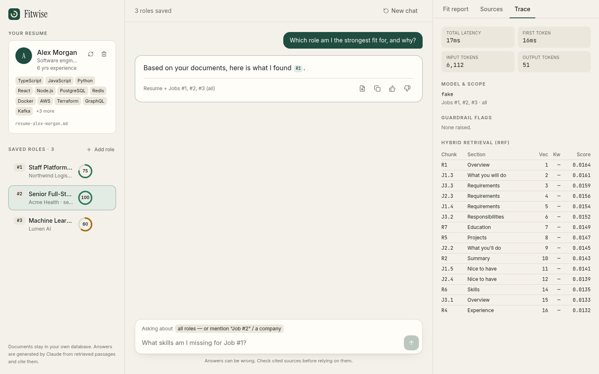
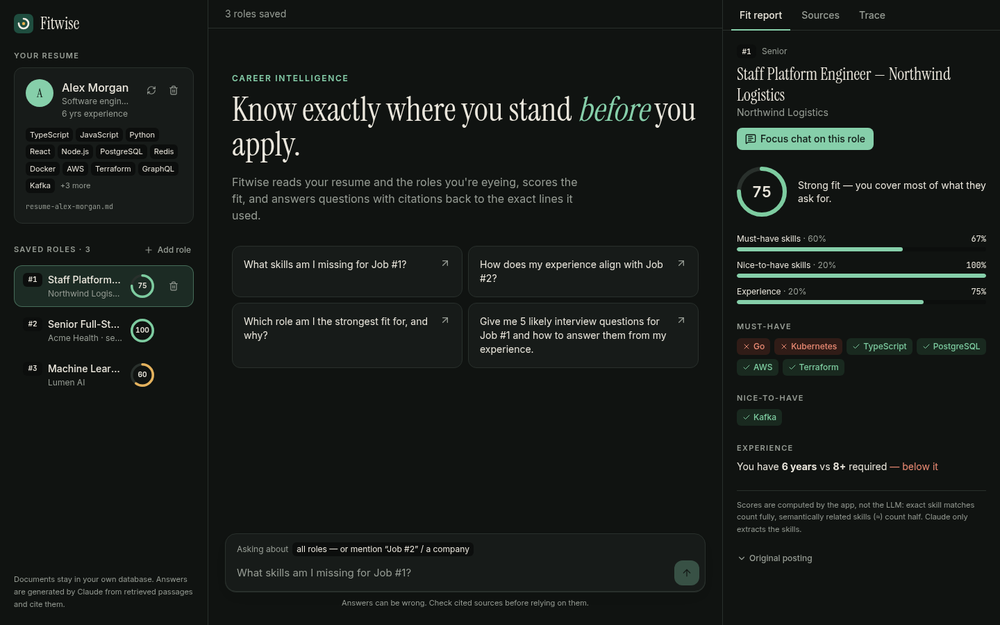
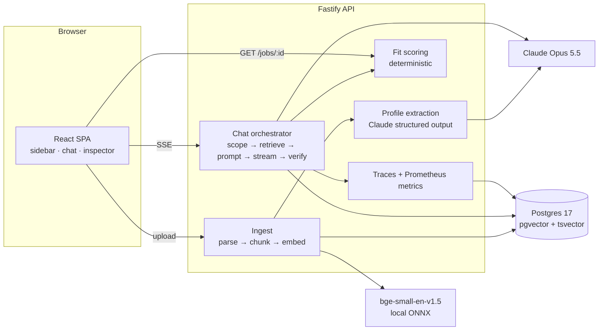

# Fitwise — career intelligence assistant

Upload a resume and the job postings you're considering. Fitwise scores each role, shows exactly which skills match, which are close and which are missing, and answers questions like _"What skills am I missing for Job #2?"_ or _"Prepare me for an interview at Acme"_ with citations that link back to the exact resume or posting lines it used.



| Sources behind an answer                 | Retrieval trace                      | Dark / mobile                      |
| ---------------------------------------- | ------------------------------------ | ---------------------------------- |
|  |  |  |

> These screenshots were taken with `LLM_PROVIDER=fake` so they can be reproduced without an API key. The fit scores and retrieval are real. The answer text comes from the fake model.

---

## Quick start

You need Docker and an Anthropic API key.

```bash
cp .env.example .env            # put your ANTHROPIC_API_KEY in it
docker compose --env-file .env up --build
open http://localhost:8080
```

Then upload `samples/resume-alex-morgan.md` and the three postings in `samples/jobs/`.

The first upload takes a few seconds longer because the API downloads the embedding model (about 35 MB, cached in a Docker volume).

### Local development

```bash
pnpm install
pnpm db:up                      # Postgres 17 + pgvector on :5432 (DB_PORT=... to change)
pnpm dev                        # api on :3000, web on :5173 (proxies /api)
```

| Command                                            | What it does                                                                                      |
| -------------------------------------------------- | ------------------------------------------------------------------------------------------------- |
| `pnpm test`                                        | API unit and integration tests (in-memory PGlite with pgvector, fake LLM) and web component tests |
| `pnpm eval`                                        | Runs the eval set in `apps/api/eval` against `samples/`                                           |
| `pnpm typecheck && pnpm lint && pnpm format:check` | What CI runs                                                                                      |

No API key? Set `LLM_PROVIDER=fake` to run the whole app end to end with a deterministic stand-in model.

---

## Architecture



**What happens when you upload a document**

1. The text is pulled out of the PDF (`unpdf`), DOCX (`mammoth`) or plain text, then cleaned up.
2. Claude reads it once and returns a typed profile, checked against a Zod schema. A resume gives skills, years of experience and roles. A posting gives must-have and nice-to-have skills, seniority and minimum years.
3. The text is split into chunks by section (Experience, Requirements, Nice to have…). Long sections are split further, with some overlap.
4. Each chunk is embedded with its document title and section name in front, then stored with a generated `tsvector` for keyword search.

**What happens when you ask a question**

1. **Scope.** Work out which jobs the question is about. A pinned job in the UI wins. Otherwise look for "Job #2", "job 1 and 3", "the second role", "last job", a company name or a job title. If nothing matches, use all jobs.
2. **Retrieve.** Run pgvector cosine search and Postgres full-text search over the resume plus the scoped jobs. Merge the two lists with Reciprocal Rank Fusion, cap the number of chunks per document, and stay within a character budget.
3. **Context.** Build the prompt from the candidate profile, the profile and computed fit report for each scoped job, and the retrieved chunks. Each chunk is tagged with a stable id: `R3` for resume chunk 3, `J2.1` for chunk 1 of Job #2.
4. **Generate.** Stream Claude's answer to the browser over SSE.
5. **Verify.** Pull the citations out of the answer and check each one against the chunks that were actually retrieved. Unknown citations, missing citations and possible prompt injection are flagged in the UI and stored on the trace.

**Repo layout**

```
apps/api      Fastify service (src/{ingest,documents,analysis,retrieval,chat,llm,embeddings,routes,db})
apps/api/eval Eval dataset + runner
apps/web      React SPA
samples/      Demo resume and job postings
```

---

## RAG / LLM decisions

### LLM — Claude Opus 5.5

- **Considered:** Claude Sonnet 5.5, Haiku 5.5, GPT-class models, a local Llama.
- **Chose Opus 5.5** with adaptive thinking. Chat runs at `effort: medium` and extraction at `effort: low`.
  - Answer quality matters most in two places: interview prep and gap analysis. Both reward reasoning.
  - At one user asking a handful of questions, the per-token price difference doesn't matter yet.
  - The model is set by an env var (`LLM_MODEL`). Moving bulk extraction to Sonnet or Haiku is a one-line change once the eval shows quality holds.
- **Structured outputs.** Extraction uses `messages.parse` with a Zod schema, so profiles always come back valid and typed. There's no JSON-repair code.
- **Refusal fallback.** Server-side refusal fallback (`fallbacks: "default"`) is on, so a request that a safety classifier declines is retried on a fallback model instead of failing outright.
- **Prompt caching.** The system prompt is marked for caching, so it isn't re-billed on every turn.

### Embeddings — `bge-small-en-v1.5`, run locally via transformers.js (ONNX, q8)

- **Considered:** Voyage / OpenAI embeddings (hosted, better quality), `all-MiniLM-L6-v2`.
- **Why local:**
  - No second API key.
  - Nothing leaves the box except the Claude call.
  - Fast enough on CPU for documents this size.
  - BGE retrieves better than MiniLM at the same 384 dimensions.
- **Downside:** short strings embed poorly. Similarity between skill names is noisy (AWS ↔ Amazon Web Services 0.81, PostgreSQL ↔ MySQL 0.83, TypeScript ↔ JavaScript 0.74). So embeddings are only a fallback in skill matching (see Fit scoring).
- The `Embedder` interface makes swapping in a hosted model a single class.

### Vector DB — Postgres + pgvector

- **Considered:** Qdrant, Pinecone, Chroma.
- **Why Postgres:** the data is small and relational (resume → chunks, job → chunks, traces). One database gives vectors, full-text search, transactions, cascading deletes and JSONB for profiles.
- **Tests:** they run against PGlite, which is real Postgres compiled to WASM with pgvector. The SQL under test is the same SQL that runs in production, and no Docker is needed.
- **Index:** HNSW on cosine distance.

### Orchestration — no framework

- **Considered:** LangChain, LlamaIndex.
- **Why plain code:** the pipeline is five explicit steps. Plain TypeScript keeps every prompt, ranking decision and token visible and unit-testable.
- A framework would add abstraction without removing any real complexity here.

### Chunking

- **Section-aware.** Resumes and postings have strong structure, and the section name is the most useful metadata there is. "Requirements" vs "Nice to have" changes what a skill means.
  - Headings are detected from a known list, from all-caps lines and from Markdown headings.
  - Sections over 900 characters are split on sentence or line boundaries with 150 characters of overlap.
- **Context prefix.** Each chunk is embedded as `"{doc title} — {section}\n{content}"`, so a bare "Kafka" bullet still knows which document and section it came from.

### Retrieval

- **Hybrid search, merged with RRF.** Skill names are exact tokens like "Kubernetes" or "PyTorch", and keyword search catches those reliably where dense vectors sometimes don't. Vectors handle paraphrase ("led a team" ↔ "leadership").
- **Per-document caps.** One long posting can't crowd out the resume. Comparison questions get fewer chunks per job.

### Fit scoring — deterministic, not LLM

- **Score:** 60% must-have coverage + 20% nice-to-have + 20% experience (`min(1, years / required)`).
- **Matching:**
  - A curated alias table counts as an exact match (k8s → Kubernetes, Postgres → PostgreSQL, React.js → React).
  - Otherwise embedding similarity ≥ 0.82 counts as **related**, for half credit, and the UI shows which resume skill it matched.
- **Why not ask the LLM for a score:** an LLM score drifts between runs and can't be explained. This one is reproducible, unit-tested and auditable chip by chip.
- **The LLM's role:** it gets the computed report in its context and is told not to recompute it. It explains and plans; it doesn't grade.

### Prompt and context management

- **Stable system prompt.** It holds the citation format, the "fit report numbers are authoritative" rule, the scope limits (career topics only) and the injection policy. Because it never changes, it caches well.
- **Per-turn context.** The context goes into the latest user message only. History keeps the last 6 turns, each cut to 2,000 characters, and old turns don't carry their retrieved context. That keeps the token count flat over a long conversation.
- **Source format.** Sources are sent as `<source id="J2.3" document="Job #2" section="Requirements">`, and any tags inside the document text are stripped first.

### Guardrails

| Risk                              | Mitigation                                                                                                                                                                                                                |
| --------------------------------- | ------------------------------------------------------------------------------------------------------------------------------------------------------------------------------------------------------------------------- |
| Prompt injection in uploaded docs | Docs are wrapped in tags, and tag-like text inside them is stripped. The system prompt says sources are data, and the model must mention it if a document contained instructions. Extraction prompts carry the same rule. |
| Prompt injection in questions     | Pattern detector flags these and stores the flag on the trace. Not blocked, because false positives would be worse for users.                                                                                             |
| Hallucinated sources              | Every `[R#]` / `[J#.#]` citation is checked against what was retrieved. The UI strikes through unknown ones with a warning. Answers with no citations get flagged.                                                        |
| Off-topic use                     | System prompt keeps the model to career topics. The eval includes an off-topic case.                                                                                                                                      |
| Wrong job referenced              | Asking about "Job #7" when there are only 3 raises `unknown_job_reference` and the UI shows it.                                                                                                                           |
| Abuse / cost                      | 2,000-character question limit, 5 MB upload limit, 60k-character document limit, Zod validation on every route.                                                                                                           |
| Scanned PDFs                      | Documents under 200 characters of text are rejected with an explanation.                                                                                                                                                  |

### Quality

- **Unit tests** cover the deterministic core: chunking, skill normalisation, fit scoring, scope resolution, RRF, guardrails and citation parsing.
- **Integration tests** cover the full HTTP flow on PGlite: upload → numbering → fit → SSE chat → trace → feedback → delete.
- **Eval harness** (`pnpm eval`) runs 10 labelled questions over `samples/`. It reports scope accuracy, source recall, MRR of the first expected source, guardrail flag accuracy and citation validity. With a key set, it also reports a must-mention rate for answer content.
  - Current baseline with local embeddings: scope 1.0, recall 1.0, MRR 0.58.
  - Recall is trivially high because the documents are small. MRR is the number to improve.
  - The eval already caught one real bug: "Northwind" didn't match the company "Northwind Logistics".
- **User feedback.** Thumbs up/down on each answer is stored on its trace, so bad answers can be pulled into the eval set.

### Observability

- **Logs:** structured pino logs with a request id that is echoed in `x-request-id`.
- **Prometheus `/metrics`:** HTTP latency, time to first token, retrieval latency, ingestion time, LLM tokens in/out, chat outcomes and guardrail flags by type.
- **Trace per answer** (`traces` table, shown in the **Trace** tab):
  - the question and resolved scope
  - each retrieved chunk with its vector rank, keyword rank and RRF score
  - flags, model, latency, first-token latency and token counts
  - user feedback
- **Health:** `/health` (liveness) and `/ready` (checks the DB).

---

## Key technical decisions

1. **"LLM extracts, code decides."** Claude turns messy documents into typed data and turns data into advice. Everything that needs to be repeatable is plain code: scores, scope, citation checks. This is the decision the rest of the design hangs on.
2. **Jobs get stable numbers** (`#1`, `#2`…) that are never reused, so "Job #2" means the same thing in the UI, the prompt, citations and traces.
3. **One resume at a time.** Uploading a new one replaces the old one in a single transaction. Multi-profile support adds little to the core problem.
4. **SSE over WebSockets.** The data only flows one way. SSE works through nginx and load balancers with `proxy_buffering off`, and it's easy to test with `inject()`.
5. **Fastify + Zod + Drizzle.** Typed end to end, small, fast to boot. Drizzle keeps SQL visible, and the hybrid search is a couple of readable queries.
6. **Dependencies are injected at the app factory.** `buildApp({ db, llm, embedder })` makes the full HTTP stack testable with fakes in milliseconds.
7. **Hand-written SQL migrations** with a ~20-line runner. That's all the tooling the project needs, and the same migration runs on Postgres and PGlite.
